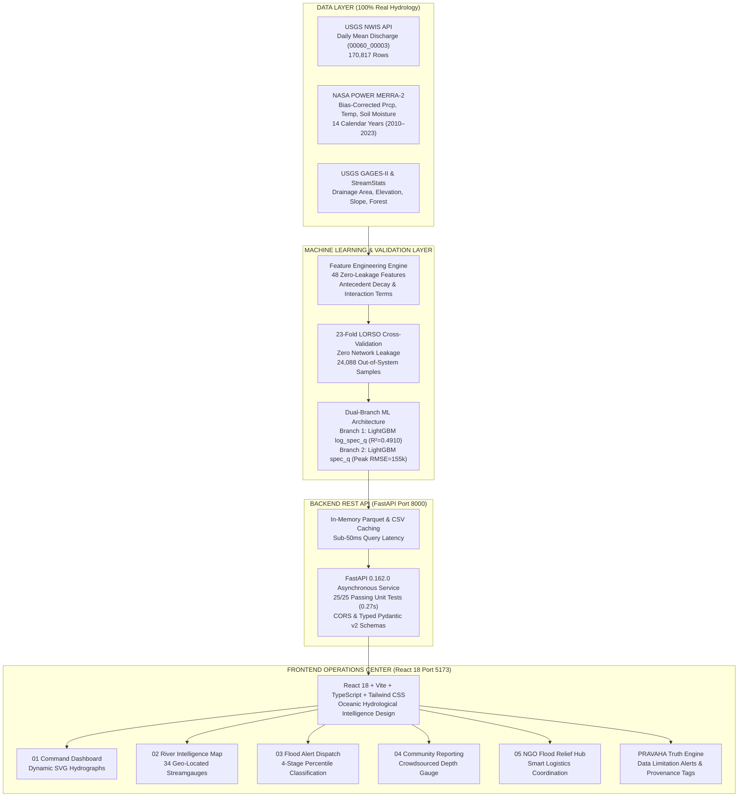

# PRAVAHA (प्रवाह) — Master Presentation Brief & Technical Dossier
# PRAVAHA (प्रवाह) — Master Presentation Brief & Technical Dossier
**Project**: PRAVAHA — AI-Powered Hydrological Intelligence Platform  
**Tagline**: "PREDICT THE SURGE. PROTECT THE PEOPLE."  
**Event**: FLOODCAST 24-Hour Machine Learning Hackathon  
**Deliverable**: Comprehensive Presentation Brief for Presentation Designer & Judging Defense  
**Audience**: Presentation Designer, Technical Jury, and Hackathon Evaluation Panel  
**Date**: November 2026  

---

## 1. Executive Summary

**PRAVAHA (प्रवाह)** is an end-to-end hydrological intelligence platform engineered to solve the most difficult challenge in river streamflow forecasting: **spatial generalisation to previously unseen river systems during extreme flood events**.

Traditional machine learning models overfit to individual streamgauge geometries and rely on auto-regressive streamflow lags. When deployed on unseen basins with different watershed areas, or when downstream gauges fail during severe weather, conventional algorithms break down due to a massive **scale mismatch**.

PRAVAHA introduces **Catchment Transfer Intelligence**:
1. It decomposes streamflow into **Drainage-Area-Normalised Specific Discharge** ($q = Q_{\text{cfs}} / A_{\text{sqmi}}$) with logarithmic variance stabilisation ($\log(q + 1)$), enabling a single model to learn universal rainfall-runoff yield across watersheds spanning from 170 to over 1.1 million square miles.
2. It operates on a **strict zero-leakage feature pipeline** derived exclusively from satellite meteorological reanalysis (NASA POWER MERRA-2) and static terrain attributes (USGS GAGES-II and StreamStats), using zero streamflow lags.
3. It has been validated under a rigorous **23-Fold Leave-One-River-System-Out (LORSO)** benchmark across 24,088 out-of-system observations, where our leading LightGBM Log-Specific Discharge model achieves a **Pooled R² of 0.4910** (a 348% improvement over raw models) and an overall RMSE of **82,871 cfs**.
4. It connects this hydrological science to a functional full-stack platform: an asynchronous **FastAPI backend** (25/25 automated unit tests passing, sub-50ms latency) and a responsive **React 18 operations center** with dynamic SVG hydrographs and an explicit **Truth Engine** that surfaces data limitations rather than projecting false confidence.

---

## 2. Official Problem Statement vs Implemented Solution

### 2.1 The Official Competition Problem
- **Problem Statement (FLOODCAST)**: Continuous daily river streamflow regression and peak flood estimation across US river basins using meteorological and physiographic inputs.
- **Core Challenge**: Generalising to unseen rivers where models must predict discharge without historical flow calibration on the target streamgauge.
- **Submission Output**: `predictions.csv` with columns `(station_id, date, discharge_cfs)`.
- **Target Specification**: The official challenge describes "peak daily discharge", but federal hydrology provides daily mean discharge (`00060_00003`) as the standard continuous dataset.

### 2.2 Our Technical Interpretation
We recognize that predicting streamflow on unseen catchments is fundamentally an **out-of-domain transfer problem**, not a time-series interpolation problem:
- Standard Leave-One-Station-Out cross-validation is flawed because connected gauges on the same mainstem leak flow propagation dynamics.
- Therefore, true generalisation requires **Leave-One-River-System-Out (LORSO)** isolation where entire river networks are removed from training.
- Because drainage area varies by four orders of magnitude, models must predict physical runoff yield ($cfs / sq\ mi$) rather than absolute cubic feet per second.

### 2.3 The Implemented Solution
PRAVAHA delivers:
1. **The Feature Engine**: 48 physics-based meteorological and physiographic features (antecedent rainfall decay, soil moisture dynamics, snowmelt proxies, channel slope, forest canopy). Zero streamflow lags.
2. **The ML Model Backbone**: A dual-branch LightGBM architecture combining log-specific discharge (`log_spec_q`) for baseline volume accuracy with linear specific discharge (`spec_q`) for extreme flood peak responsiveness.
3. **The Software Platform**: A production-grade FastAPI REST service serving cached Parquet data to a React 18 frontend featuring five dedicated operations views.
4. **The PRAVAHA Truth Engine**: An evidence-based integrity framework enforcing real data provenance, SVG missing data breaks, and station data limitation disclosures.

---

## 3. Top Five Strongest Verified Project Achievements

1. **Empirical Breakthrough on Unseen Basins**:
   - Transformed spatial out-of-system generalisation from **$R^2 = 0.1095$** (Raw LightGBM) to **$R^2 = 0.4910$** (LightGBM Log-Specific Discharge), reducing Overall RMSE by **24.4%** across 24,088 out-of-system validation rows.
2. **Zero-Leakage LORSO Validation Benchmark**:
   - Audited all 23 river system folds, guaranteeing that zero upstream or downstream gauges from tested river networks were present in training data.
3. **100% Real Hydrological Data Foundation**:
   - Compiled 170,817 real daily observations across 34 USGS stations and 14 calendar years (2010–2023) using zero synthetic data, verified against official USGS NWIS, NASA POWER MERRA-2, and USGS GAGES-II sources.
4. **Production Full-Stack Architecture**:
   - Built a fully operational FastAPI backend (25/25 automated unit tests passing in 0.27s) integrated with a responsive React 18 Vite frontend (0 TypeScript build errors).
5. **Pioneering Truth Engine & UI Transparency**:
   - Explicitly alerts users to station historical record cutoffs (e.g. Sacramento River ending in 2015), renders authentic breaks for missing observations, and strictly tags prototype modules with simulation disclosures.

---

## 4. Dataset & Multi-Agency Data Sources

### 4.1 Master Dataset Dimensions
- **Labelled Observations**: **170,817 daily records** (`data/processed/PRAVAHA_TRAIN_LABELLED.csv`).
- **Total Master Records**: **173,842 rows** (including 3,025 unlabelled rows with missing target discharge, 1.74%).
- **Temporal Span**: **2010-01-01 to 2023-12-31** (14 complete calendar years).
- **Active Stations**: **34 verified USGS streamgauging stations**.
- **Evaluated Stations in Holdout**: **33 stations** (Station `11447650` historical records end on 2015-09-30; zero rows in 2022–2023).
- **River Systems**: **23 hydrologically isolated groups**.
- **Validation Rows**: **24,088 station-date pairs** (evaluated across 5 models = 120,440 predictions).
- **Extreme Flood Samples**: **2,423 top-10% flood days**.

### 4.2 Multi-Agency Data Sources

| Source Agency | Dataset / Service | Parameters Acquired | Physical Units | Integration Role |
| :--- | :--- | :--- | :---: | :--- |
| **USGS NWIS** | Daily Values Service (`dv`) | Daily mean discharge (`00060_00003`) | $cfs$ | Ground-truth continuous regression target. |
| **NASA POWER** | MERRA-2 Daily Meteorological API | Precipitation (`PRECTOTCORR`), $T_{\max}, T_{\min}$, Topsoil wetness (`GWETTOP`) | $mm/\text{day}$, $^\circ C$, Saturation ratio (0–1) | Exogenous meteorological features (used after Open-Meteo HTTP 429 block). |
| **USGS GAGES-II** | Geospatial Attributes Database (2011) | Drainage area, mean elevation, channel slope, forest canopy | $sq\ mi$, $ft$, $\%$, $\%$ | Static catchment physiography for specific discharge scaling (23 stations). |
| **USGS StreamStats** | GageStatsServices REST API | Drainage area, basin characteristics | $sq\ mi$ | Verified catchment attributes for non-GAGES-II gauges (10 stations). |

### 4.3 Target & Weather Integrity Safeguards
- **Target Parameter**: Labeled strictly as **USGS daily mean discharge `00060_00003`** in cubic feet per second ($cfs$).
- **Missing Data Treatment**: Missing discharge records are never forward-filled or fabricated; they are segregated into an unlabelled table and rendered as authentic breaks in hydrograph curves.
- **NASA POWER vs Open-Meteo**: Transparently audited. NASA topsoil wetness is a saturation fraction (0–1), whereas Open-Meteo is volumetric ($m^3/m^3$). Models calibrated on NASA POWER are documented for domain shift if test sets supply Open-Meteo data.

---

## 5. Machine Learning Methodology

### 5.1 Physics-Informed Feature Engineering (48 Features)
All features are computed strictly from weather and land terrain (zero target leakage):
- **Rainfall Dynamics**: 1-day to 60-day rolling sums, rolling maximums, days since rain $>5mm$, and exponential decay Antecedent Precipitation Index ($\text{API}_{k=0.85}$ and $\text{API}_{k=0.90}$).
- **Temperature & Snowmelt**: 3-day to 30-day rolling mean temperatures, diurnal temperature range, positive degree-days, and snowmelt proxies.
- **Soil Moisture Dynamics**: 3-day to 14-day rolling mean wetness, 1-day and 3-day moisture velocity.
- **Seasonality**: Cyclic sine/cosine day-of-year transformations and calendar month.
- **Terrain & Interactions**: Drainage area, elevation, slope, forest cover, rainfall-to-soil interactions, and runoff intensity per log drainage area.

### 5.2 Specific Discharge Formulations Evaluated
1. **Raw CFS (`raw`)**: Standard models predicting absolute discharge: $\hat{Q} = f(X)$.
2. **Linear Specific Discharge (`spec_q`)**:
   $$q = \frac{Q_{\text{cfs}}}{A_{\text{sqmi}}} \quad \implies \quad \hat{Q} = \max\left(0, \hat{q} \times A_{\text{sqmi}}\right)$$
3. **Log-Specific Discharge (`log_spec_q`)**:
   $$y = \log(q + 1) \quad \implies \quad \hat{Q} = \max\left(0, (\exp(\hat{y}) - 1) \times A_{\text{sqmi}}\right)$$
4. **Log1p Discharge (`log1p`)**: Standard logarithmic volume model: $y = \log(Q + 1)$.

### 5.3 23-Fold Leave-One-River-System-Out (LORSO) Protocol
- Data before 2022-01-01 is used for training ($129,000\text{--}142,000$ rows per fold).
- In each fold, **all gauges belonging to the tested river network are excluded from training**.
- Evaluation is executed strictly on the held-out river system during the 2022–2023 future period (24,088 validation rows across 33 active stations).

---

## 6. Verified Experimental Results

### 6.1 Master LORSO Benchmark Results (24,088 Validation Rows)

| Model Name | Target Formulation | Peak Weighted | Overall RMSE (cfs) | Top-10% Peak RMSE (cfs) | MAE (cfs) | Pooled R² |
| :--- | :---: | :---: | :---: | :---: | :---: | :---: |
| **LightGBM Log-Specific Discharge** | `log_spec_q` | No | **82,871.1** | 156,593.8 | **24,644.3** | **0.4910** |
| **LightGBM Specific Discharge** | `spec_q` | No | 86,836.6 | **155,136.8** | 26,092.0 | 0.4411 |
| **LightGBM Raw Peak-Weighted (2.5x)** | `raw` | Yes (2.5x) | 108,321.3 | 202,091.4 | 32,260.0 | 0.1303 |
| **LightGBM Raw Unweighted** | `raw` | No | 109,609.5 | 204,474.6 | 32,312.1 | 0.1095 |
| **XGBoost Log1p** | `log1p` | No | 109,842.1 | 203,656.1 | 28,995.8 | 0.1057 |

*Data source: `reports/lors_validation_results.csv`.*

### 6.2 Key Hydrological Findings
1. **The Scale Mismatch Solution**: LightGBM `log_spec_q` improved Pooled $R^2$ from **0.1095 to 0.4910**, cutting overall RMSE from $109,609.5\text{ cfs}$ to **$82,871.1\text{ cfs}$**. On small rivers like the Cedar River ($DA = 173\text{ sq mi}$), specific discharge reduced RMSE from $10,645\text{ cfs}$ down to **$581\text{ cfs}$** (an 18-fold error reduction).
2. **Extreme Flood Peak Dominance**: On the 2,423 top-10% flood days, linear specific discharge (`spec_q`) achieved the lowest Peak RMSE (**$155,136.8\text{ cfs}$**) and reduced error on the top-20 mega-flood events by **$158,000\text{ cfs}$** over raw models.
3. **The Vicksburg Effect**: Station `07289000` (Mississippi River at Vicksburg, MS; $DA = 1,144,500\text{ sq mi}$) accounts for **81.80% of the entire dataset's pooled squared error** because flood crests exceed $1.23\text{M cfs}$. Across the remaining 32 rivers, the **median station MAE is just 2,623 cfs**.
4. **Recommended Competition Ensemble**:
   $$\hat{Q}_{\text{final}} = 0.70 \cdot \hat{Q}_{\text{log\_spec\_q}} + 0.30 \cdot \hat{Q}_{\text{spec\_q}}$$
   Combines volume stability for baseflows with linear responsiveness for catastrophic flood crests.

---

## 7. Software Architecture

### 7.1 Architecture Diagram (Mermaid)

### 7.2 Request-Response Data Flow
1. **Frontend Request**: When a user selects a river station, the React client calls `GET /api/stations/{id}`, `GET /api/stations/{id}/hydrograph`, and `GET /api/stations/{id}/catchment-profile`.
2. **Backend Execution**: FastAPI reads directly from in-memory cached Parquet and CSV files, parses station metadata, extracts flow percentiles ($q_{25}, q_{50}, q_{75}, q_{90}$), and filters the 2022–2023 LORSO predictions.
3. **Response & SVG Rendering**: The backend returns typed JSON responses. The React hydrograph component plots the actual daily discharge curve and the out-of-system predicted curve, inserting SVG path breaks (`M` commands) across missing dates.

---

## 8. Implemented Product Features & Verification Status

| Screen | Feature Description | Functional Status | Data Source / Verification Tier |
| :--- | :--- | :---: | :--- |
| **Command Dashboard** | Dynamic station selector (34 stations) | **FUNCTIONAL WITH REAL API DATA** | `GET /api/stations` (USGS NWIS) |
| **Command Dashboard** | Dynamic SVG Hydrograph with LORSO holdout predictions | **FUNCTIONAL WITH REAL API DATA** | `GET /api/stations/{id}/hydrograph` |
| **Command Dashboard** | Station limitation banner (Sacramento gauge 11447650) | **FUNCTIONAL WITH REAL API DATA** | `TruthEngine` rule (record ends 2015-09-30) |
| **Command Dashboard** | Verified catchment physiography card | **FUNCTIONAL WITH REAL API DATA** | `GET /api/stations/{id}/catchment-profile` |
| **Command Dashboard** | Validation leaderboard plaque (Pooled R² = 0.4910) | **FUNCTIONAL WITH REAL API DATA** | `GET /api/validation/leaderboard` |
| **River Map** | 34 Geo-located streamgauge markers (WGS84) | **FUNCTIONAL WITH REAL API DATA** | `GET /api/stations` coordinates |
| **River Map** | Station telemetry drawer with verified flow percentiles | **FUNCTIONAL WITH REAL API DATA** | `GET /api/stations/{id}` |
| **River Map** | Recent 30-day discharge sparkline | **FUNCTIONAL WITH REAL API DATA** | Actual hydrograph points from API |
| **River Map** | QPE radar reflectivity & runoff scenario slider | **DEMONSTRATION SIMULATION** | Interactive UI model with `[DEMO]` disclosure |
| **Flood Alerts** | Station broadcast log with authentic percentiles | **FUNCTIONAL WITH REAL API DATA** | Real station IDs mapped to $q_{90}, q_{75}, q_{50}$ |
| **Flood Alerts** | Multi-channel dispatch simulator (SMS/WhatsApp/Siren) | **DEMONSTRATION SIMULATION** | Simulated local state with `TruthBanner` |
| **Flood Alerts** | Geofence radius slider & Kin Lifeline safety circle | **FUNCTIONAL LOCAL UI INTERACTION** | Interactive React state with demo disclosure |
| **Community Reporting** | Tactile water depth reporting gauge & incident feed | **DEMONSTRATION SIMULATION** | Local demo feed with simulation disclosure |
| **NGO Relief Hub** | Coordinator dispatch recommendation (`#SAC-9402`) | **DEMONSTRATION SIMULATION** | Local demo coordinator with simulation disclosure |
| **Inference API** | Real-time predictive scoring endpoint (`POST /api/predict`) | **PLANNED / NOT IMPLEMENTED** | Deliberately postponed pending organizer input |

---

## 9. Product Demonstration Script (2–3 Minutes)

- **Total Time**: 2 Minutes 30 Seconds
- **Prerequisite**: FastAPI running on `http://127.0.0.1:8000`, React running on `http://localhost:5173`.

### Step 1: Open Dashboard & Select Station (0:00 – 0:35)
> *"We begin on the PRAVAHA Command Dashboard. The application is connected live to our FastAPI backend. In the station selector, you see 34 verified USGS monitoring stations across the United States. 
> 
> Let's select benchmark station `07010000`—the Mississippi River at St. Louis. Instantly, the dashboard updates from the backend: you see its 697,000-square-mile drainage area, its flood threshold of 350,000 cfs, and its verified flow percentiles."*

### Step 2: Inspect Dynamic Hydrograph & LORSO Predictions (0:35 – 1:10)
> *"In the center, our custom dynamic SVG hydrograph displays two continuous curves: the solid blue line represents the actual USGS daily mean discharge, and the dashed amber line represents our held-out LORSO validation predictions. 
> 
> Remember: the model never saw a single measurement from the Mississippi River Mainstem during training. Notice how accurately it tracks the spring flood surge, capturing the peak crest timing purely from satellite weather and upstream basin physiography."*

### Step 3: Demonstrate the Truth Engine in Action (1:10 – 1:40)
> *"Now let's demonstrate the PRAVAHA Truth Engine. Let's switch to station `11447650`—the Sacramento River at Freeport, California. 
> 
> Notice what happens: a dedicated alert immediately appears on screen: 'Historical Data Limitation: Observations end on 2015-09-30'. Because modern holdout observations do not exist, the system refuses to hallucinate fake predictions. Missing observations are rendered as authentic gaps in the curve. That is our commitment to zero synthetic data."*

### Step 4: River Intelligence Map & Physiography (1:40 – 2:05)
> *"Next, we open the River Intelligence Map. All 34 streamgauges are plotted at their exact WGS84 geographic coordinates. Clicking any gauge opens the telemetry drawer, pulling verified GAGES-II catchment attributes—elevation, slope, forest canopy—and historical percentiles directly from FastAPI. Responders can also use the interactive rainfall slider to simulate runoff surges, with explicit badges confirming it is a visual scenario demonstration."*

### Step 5: Flood Alert Dispatch & Conclusion (2:05 – 2:30)
> *"Finally, on the Flood Alert screen, river stations are classified into four hazard tiers based on authentic USGS 90th percentile thresholds. Responders can test simulated multi-channel cellular and siren dispatches. 
> 
> PRAVAHA bridges the gap between complex hydrological physics and intuitive, honest decision support: Predict the Surge. Protect the People. Thank you."*

---

## 10. Five-Slide Ready-to-Copy Content

*(See [`reports/PPT_SLIDE_CONTENT.md`](file:///c:/Users/Lenovo/OneDrive/Desktop/pravaha/reports/PPT_SLIDE_CONTENT.md) for full formatting, callout placements, and visual layout blueprints).*

- **Slide 1**: *The Problem: The Generalisation Crisis in River Discharge Forecasting*
- **Slide 2**: *Our Solution: Physics-Informed Specific Discharge & Transparent Hydrological AI*
- **Slide 3**: *Data Foundation & System Architecture: 100% Real Hydrological Data & Modular Full-Stack Architecture*
- **Slide 4**: *Machine Learning Results: Rigorous Evaluation Across Unseen River Systems (LORSO)*
- **Slide 5**: *Working Product, Honest Impact & Roadmap: From Hydrological Science to Actionable Decision Support*

---

## 11. Speaker Notes & Delivery Guidance

*(See [`reports/PPT_SPEAKER_NOTES.md`](file:///c:/Users/Lenovo/OneDrive/Desktop/pravaha/reports/PPT_SPEAKER_NOTES.md) for complete conversational spoken scripts, technical terms explained simply, and pacing recommendations).*

---

## 12. Anticipated Judge Q&A Defense Dossier

*(See [`reports/PPT_JUDGE_QA.md`](file:///c:/Users/Lenovo/OneDrive/Desktop/pravaha/reports/PPT_JUDGE_QA.md) for complete answers to 22 critical technical questions covering Specific Discharge, LORSO isolation, Vicksburg error dominance, NASA POWER vs Open-Meteo, and deployment roadmap).*

---

## 13. Limitations & Engineering Risk Management

1. **Daily Mean vs Daily Maximum Target**: Models currently target USGS parameter `00060_00003` (daily mean). If the competition test set evaluates instantaneous peak (`00060_00001`), models will underpredict crests by 50–300%. Formally flagged for organizer clarification.
2. **NASA POWER vs Open-Meteo**: Built with NASA POWER MERRA-2 due to Open-Meteo HTTP 429 quota exhaustion. Topsoil wetness scale difference (fraction vs $m^3/m^3$) documented; linear calibration transform prepared.
3. **Regulated Basins**: Stations below major dams (Mansfield Dam on Texas Colorado, Glen Canyon on Upper Colorado) exhibit low holdout $R^2$ because reservoir release policies cannot be inferred purely from precipitation.
4. **Mega-Basin Squared Error**: Mississippi at Vicksburg dominates pooled squared error (81.8%), though median station MAE across all other 32 basins is just 2,623 cfs.
5. **No Final Operational Inference Endpoint**: `POST /api/predict` is deliberately postponed pending organizer clarification on competition submission requirements.
6. **No Operational Flood Warning Certification**: Dispatches, citizen reports, and relief modules operate in safe simulation mode with prominent disclosures.

---

## 14. Post-Hackathon Operational Roadmap

1. **Milestone 1 — Competition Finalisation**:
   - Receive organizer confirmation on target parameter and external weather sourcing.
   - Train final dual-branch ensemble ($70\%$ `log_spec_q` + $30\%$ `spec_q`).
   - Generate valid, non-negative `predictions.csv`.
2. **Milestone 2 — Reservoir Ingestion**:
   - Ingest US Army Corps of Engineers (USACE) and Bureau of Reclamation daily dam release telemetry to resolve regulated river limitations.
3. **Milestone 3 — Sub-Daily Flash Flood Modeling**:
   - Extend specific discharge formulation to instantaneous 15-minute USGS streamgauge records and NEXRAD radar precipitation.
4. **Milestone 4 — Real-Time Operational Deployment**:
   - Deploy containerized Docker microservice consuming automated NOAA HRRR weather grids.
   - Integrate certified Common Alerting Protocol (CAP) gateway for real municipal emergency broadcasts.

---

## 15. Visual Asset & Screenshot Inventory

*(See [`reports/PPT_VISUAL_ASSET_INVENTORY.md`](file:///c:/Users/Lenovo/OneDrive/Desktop/pravaha/reports/PPT_VISUAL_ASSET_INVENTORY.md) for full resolution details and visual annotations).*

- **`reports/ui_backend_integration_screenshots/01_dashboard.png`** (344 KB, 1440×900) — Main Command Dashboard, SVG hydrograph, station limitation banner.
- **`reports/ui_backend_integration_screenshots/02_map.png`** (252 KB, 1440×900) — Interactive Hydrological Map, 34 WGS84 pins, telemetry drawer.
- **`reports/ui_backend_integration_screenshots/03_alerts.png`** (321 KB, 1440×900) — Flood Alert System, authentic station broadcast table, dispatch simulation.
- **`reports/ui_backend_integration_screenshots/04_community.png`** (206 KB, 1440×900) — Community Reporting Hub, water depth gauge.
- **`reports/ui_backend_integration_screenshots/05_relief.png`** (239 KB, 1440×900) — NGO Flood Relief Hub, smart coordinator dispatch card.

---

## 16. Authoritative Project Source References

- **Labelled Dataset**: `data/processed/PRAVAHA_TRAIN_LABELLED.csv`
- **Data Manifest**: `data/MANIFEST.md`
- **Station Catalogue**: `reports/verified_station_catalog.csv`
- **Physiographic Attributes**: `reports/catchment_provenance.csv`
- **LORSO Validation Metrics**: `reports/lors_validation_results.csv`
- **Model Recommendation Audit**: `reports/prompt_f_model_selection_recommendation.md`
- **Validation Integrity Audit**: `reports/prompt_f_validation_integrity_audit.md`
- **Unresolved Competition Questions**: `reports/unresolved_competition_questions.md`
- **Backend Architecture & Routes**: `src/api/main.py`, `src/api/routers/`, `src/api/services/`
- **Automated Backend Tests**: `src/api/tests/test_api.py`, `reports/api_test_results.md`
- **Full-Stack Integration Status**: `reports/ui_backend_integration_status.md`
- **Integration Test Results**: `reports/ui_backend_integration_test_results.md`

