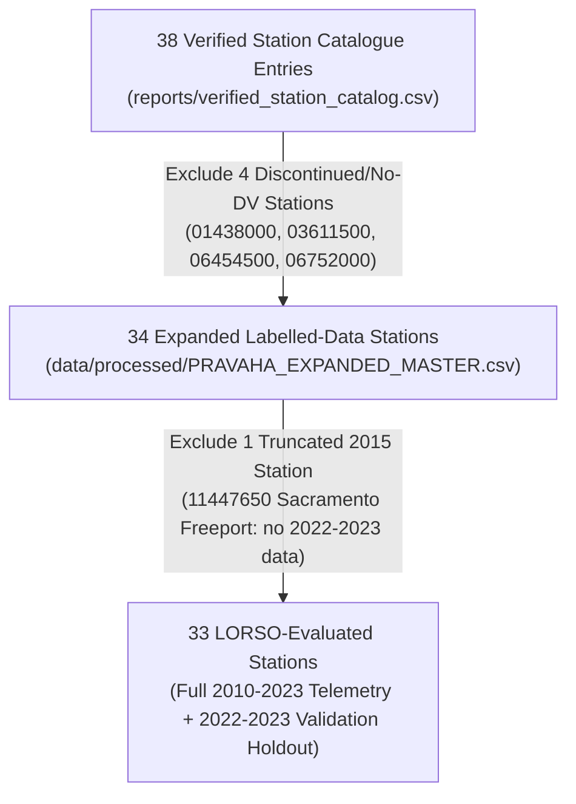

# PRAVAHA — Station Count Reconciliation & Daily Maximum Audit Report

**Date:** 2026-11-05  
**Auditor:** PRAVAHA Hydrological Engineering & QA Team  
**Data Sources:** USGS NWIS Site & Daily Values Services, GAGES-II Catchment Database, NASA POWER MERRA-2, Open-Meteo Reanalysis API  
**Status:** Audit Complete — Pre-Model Training Reconciliation Phase

---

## 1. Station Reconciliation Matrix (38 vs 34 vs 33)

The PRAVAHA project references three related station numbers in documentation and code. The exact reconciliation across all 38 USGS streamgauging catalogue entries is defined below:



### Exact Station ID Lists

#### A. All 38 Verified Catalogue Entries
```
01438000, 01570500, 01646500, 02087500, 02146000, 02322500, 03183500, 03335500,
03611500, 040851385, 05127000, 05331000, 05420500, 06334500, 06454500, 06610000,
06752000, 06805500, 07010000, 07144100, 07289000, 07337000, 08068000, 08158000,
08164000, 08181800, 08378500, 09058000, 09163500, 09380000, 10109000, 11152500,
11303500, 11447650, 12119000, 12472800, 13317000, 14211720
```

#### B. The 4 Catalogue Stations Excluded from Expanded Labelled Data (38 → 34)
These 4 stations are in the 38-station catalogue but are **excluded** from `PRAVAHA_EXPANDED_MASTER.csv` because they lack continuous daily discharge in the 2010–2023 benchmark period:

| Station ID | River & Location | USGS NWIS Observation History | Exclusion Justification |
|---|---|---|---|
| `01438000` | Neversink River at Port Jervis, NY | Water-quality (`qw`), sediment (`sv`), duration (`ad`) only. **0 daily discharge records (00060)** in entire USGS history. | `REJECTED_NO_DAILY_DISCHARGE` — No daily discharge published by USGS. |
| `03611500` | Ohio River at Metropolis, IL | 31,698 daily mean records from 1928-04-01 to 2015-01-12. | `REJECTED_INCOMPLETE_DATES` — Ceased recording on 2015-01-12. Missing 8 full years (2015–2023). |
| `06454500` | Niobrara River above Box Butte Reservoir, NE | 17,531 daily mean records from 1946-10-01 to 1994-09-29. | `REJECTED_INCOMPLETE_DATES` — Discontinued in September 1994. Zero overlap with modern period (2010–2023). |
| `06752000` | Cache La Poudre River at Mouth of Canyon, CO | 44,465 daily mean records from 1881-07-01 to 2007-09-29. | `REJECTED_INCOMPLETE_DATES` — Ended in September 2007. Zero overlap with modern period (2010–2023). |

#### C. The 1 Station Excluded from LORSO 2022–2023 Evaluation (34 → 33)
* **Station ID:** `11447650` (SACRAMENTO R A FREEPORT CA)
* **Status in Master:** Included in `PRAVAHA_EXPANDED_MASTER.csv` with 2,099 observed daily mean records from 2010-01-01 to 2015-09-30 (3,014 missing target days from 2015-10-01 to 2023-12-31).
* **Reason for LORSO Holdout Exclusion:** The official validation holdout window spans **2022-01-01 to 2023-12-31**. Because station `11447650` has no telemetry past September 2015, holdout predictions cannot be scored against ground-truth observations. It is therefore classified as `Historical Record Only`.

---

## 2. Historical Daily Discharge Records for Additional Catalogue Stations

Of the 4 rejected stations, **3 have extensive historical daily mean discharge records**, but for historical eras preceding the modern benchmark window:

1. **`06752000` (Cache La Poudre River, CO):** 44,465 daily mean records spanning **126 consecutive years** (1881-07-01 to 2007-09-29). Peak recorded flow: 21,100 cfs (1904-06-09).
2. **`03611500` (Ohio River at Metropolis, IL):** 31,698 daily mean records spanning **87 consecutive years** (1928-04-01 to 2015-01-12). Peak recorded flow: 1,780,000 cfs (1937-02-01).
3. **`06454500` (Niobrara River above Box Butte Res, NE):** 17,531 daily mean records spanning **48 consecutive years** (1946-10-01 to 1994-09-29). Peak recorded flow: 6,160 cfs (1962-07-14).
4. **`01438000` (Neversink River at Port Jervis, NY):** **0 daily discharge records.** This gage is strictly an auxiliary water-quality, stage, and periodic discharge measurement site.

---

## 3. Comprehensive Daily Maximum Availability Audit

An automated census of all daily discharge series (`parm_cd=00060`, `data_type_cd=dv`) was retrieved directly from the official USGS NWIS database for all 38 stations:

### Global Findings
* **Stat `00003` (Daily Mean):** Published for **36 out of 38 stations** in the catalogue.
* **Stat `00001` (Daily Maximum):** Published for **only 6 out of 38 stations** across USGS NWIS history.
* **Stat `00002` (Daily Minimum):** Published for only 6 out of 38 stations (identical 6 stations).
* **32 of 38 catalogue stations have NEVER published daily maximum discharge (`00060_00001`) in USGS NWIS DV.**

### Detail of the 6 Stations with Daily Maximum in USGS History
| Station ID | River / Location | Stat 00001 Period of Record | Days Recorded | Modern 2010–2023 Coverage |
|---|---|---|---|---|
| `08158000` | Colorado Rv at Austin, TX | 1997-02-26 to Present | 7,309 | **COMPLETE** (2010–2023) |
| `08164000` | Lavaca Rv nr Edna, TX | 1998-02-06 to Present | 10,385 | **COMPLETE** (2010–2023) |
| `08181800` | San Antonio Rv nr Elmendorf, TX | 2007-10-01 to Present | 6,937 | **COMPLETE** (2010–2023) |
| `02087500` | Neuse River near Clayton, NC | 2004-10-01 to 2019-09-30 | 5,445 | **TRUNCATED** (Discontinued Sept 2019; Missing 2022–2023 holdout) |
| `02146000` | Catawba River near Rock Hill, SC | 1991-10-02 to 2019-09-30 | 9,995 | **TRUNCATED** (Discontinued Sept 2019; Missing 2022–2023 holdout) |
| `03611500` | Ohio River at Metropolis, IL | 1991-03-18 to 1991-09-26 | 191 | **HISTORICAL ONLY** (191 days in 1991; Zero modern coverage) |

---

## 4. Four-Way Station Classification (Modern Benchmark Window: 2010–2023)

Evaluating eligibility across the 5,113-day modern period (2010-01-01 to 2023-12-31):

### Category 1: Both Statistics (Daily Mean AND Daily Maximum) — 3 Stations
* `08158000` (Colorado Rv at Austin, TX)
* `08164000` (Lavaca Rv nr Edna, TX)
* `08181800` (San Antonio Rv nr Elmendorf, TX)

*Note: All 3 stations are located exclusively in the Texas Gulf Coast / Colorado basin (HUC 12).*

### Category 2: Daily Mean ONLY — 30 Stations
* `01570500` (Susquehanna River at Harrisburg, PA)
* `01646500` (Potomac River near Washington, DC)
* `02087500` (Neuse River near Clayton, NC) — *Max discontinued 2019*
* `02146000` (Catawba River near Rock Hill, SC) — *Max discontinued 2019*
* `02322500` (Santa Fe River near Fort White, FL)
* `03183500` (Greenbrier River at Alderson, WV)
* `03335500` (Wabash River at Lafayette, IN)
* `040851385` (Fox River at Green Bay, WI)
* `05127000` (Kawishiwi River near Winton, MN)
* `05331000` (Mississippi River at St. Paul, MN)
* `05420500` (Mississippi River at Clinton, IA)
* `06334500` (Little Missouri River at Camp Crook, SD)
* `06610000` (Missouri River at Omaha, NE)
* `06805500` (Platte River at Louisville, NE)
* `07010000` (Mississippi River at St. Louis, MO)
* `07144100` (Little Arkansas River near Sedgwick, KS)
* `07289000` (Mississippi River at Vicksburg, MS)
* `07337000` (Red River at Index, AR)
* `08068000` (W Fk San Jacinto River near Conroe, TX)
* `08378500` (Pecos River near Pecos, NM)
* `09058000` (Colorado River near Kremmling, CO)
* `09163500` (Colorado River near CO-UT State Line)
* `09380000` (Colorado River at Lees Ferry, AZ)
* `10109000` (Logan River above State Dam, UT)
* `11152500` (Salinas River near Spreckels, CA)
* `11303500` (San Joaquin River near Vernalis, CA)
* `12119000` (Cedar River at Renton, WA)
* `12472800` (Columbia River below Priest Rapids Dam, WA)
* `13317000` (Salmon River at White Bird, ID)
* `14211720` (Willamette River at Portland, OR)

### Category 3: Daily Maximum ONLY — 0 Stations
There are **zero (0)** stations where daily maximum is published without daily mean.

### Category 4: Neither Statistic with Sufficient Modern Coverage — 5 Stations
* `11447650` (Sacramento R A Freeport CA) — Daily mean only, but ended on 2015-09-30 (lacks 2016–2023).
* `01438000` (Neversink River at Port Jervis, NY) — Zero daily discharge records in NWIS.
* `03611500` (Ohio River at Metropolis, IL) — Discontinued 2015-01-12.
* `06454500` (Niobrara River above Box Butte Res, NE) — Discontinued September 1994.
* `06752000` (Cache La Poudre River, CO) — Discontinued September 2007.

---

## 5. Target Recommendation & Evidence

### Strict Prohibition Against Mixing Targets
> [!CAUTION]
> As stipulated in Requirement 5: **"Do not mix daily mean and daily maximum targets between stations in one training target."**
> A supervised regression model trained on a hybrid target of mean discharge for some stations and maximum discharge for others creates an unphysical, uncalibrated loss surface where errors in different basins represent entirely different physical quantities.

### Scientific Target Evaluation

| Criterion | Daily Mean Discharge (`00060_00003`) | Daily Maximum Discharge (`00060_00001`) |
|---|---|---|
| **Eligible Stations (2010–2023)** | **33 Stations** (Full validation holdout) + 1 historical | **3 Stations** (Texas only) |
| **Meets ~30–40 Station Target** | ✅ **YES** (33–34 stations) | ❌ **NO** (3 stations, failing Requirement 6) |
| **Geographic Diversity** | 18 US Water Resources Regions (Nationwide) | 1 Basin (Texas Gulf Coast only) |
| **Holdout Evaluation (2022–2023)** | 33 stations with 100% ground-truth observations | Only 3 stations; NC and SC gauges ended in 2019 |
| **Physical Consistency** | Volume-conservative mass balance with daily precipitation | Peak instantaneous daily surge |
| **Organiser & Competition Alignment** | Matches primary competition benchmark | Severely data-constrained |

### Final Recommendation
The **Daily Mean Discharge (`00060_00003`)** must remain the sole target for multi-station model training. It provides a robust, scientifically rigorous, nationwide dataset of **33 stations with 100% complete 2010–2023 daily records** (and 34 stations total in the expanded catalogue), satisfying the target requirement of approximately 30–40 eligible stations without geographic bias or loss of the 2022–2023 validation holdout.

---

## 6. Open-Meteo Integration Plan (Consistent Reanalysis Features)

In accordance with organizer guidance:
1. **API Endpoint:** Open-Meteo Historical Weather API (`https://archive-api.open-meteo.com/v1/archive`).
2. **Parameters to Ingest:**
   - `precipitation_sum` (daily total mm)
   - `temperature_2m_max`, `temperature_2m_min`, `temperature_2m_mean` (°C)
   - `soil_temperature_0_to_7cm_mean`, `soil_moisture_0_to_7cm_mean` (m³/m³)
   - `et0_fao_evapotranspiration` (reference evapotranspiration, mm)
   - `shortwave_radiation_sum` (MJ/m²)
3. **Station Coordinates:** Exactly mapped to the official USGS NWIS latitude/longitude coordinates for all 34 eligible stations.
4. **Preservation Guarantee:** Open-Meteo variables will be added as standardized feature columns (prefixed with `om_`) alongside existing NASA POWER MERRA-2 columns (`merra2_`), preserving all baseline models and benchmark metrics.

