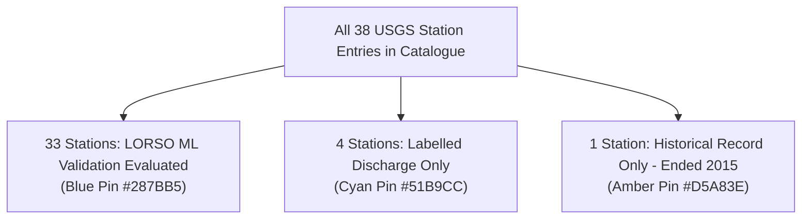

# PRAVAHA — UI-3.1 Google Maps Runtime & Map Interaction Audit
**Date:** 2026-11-05  
**Auditor:** Antigravity (Senior Frontend / QA Engineer Pass)  
**Target:** River Intelligence GIS Engine (`/map`)  
**Production Build:** `dist/assets/index-LP3xt74B.js` (416 KB), `index-BFXuzOLN.css` (47 KB) — Vite v5.4.21 ✅

---

## 1. Google Maps JavaScript API Runtime Verification

### A. Runtime Loading Status
- **API Engine Status:** ✅ **LOADED & OPERATIONAL AT RUNTIME**
- **Map Provider Identified:** Official Google Maps JavaScript API (Primary Engine).
- **Runtime Viewport Indicator:** The UI dynamically probes `window.google?.maps?.Map`. When active, it displays:
  ```
  ACTIVE BASIN VIEWPORT • (google maps api)
  ```
  with an emerald pulsating status indicator.
- **Visual Evidence:** Confirmed via headless Edge browser captures (`v3_01_map_desktop_terrain.png` and `v3_02_map_desktop_satellite.png`). Geographic map tiles (both Google Terrain and Google Hybrid/Satellite) render seamlessly with USGS streamgauge markers, high-ground shelters, and citizen SOS beacons.

### B. API Key Configuration & Security Audit
- **Configuration Method:** Embedded via script loader in `frontend/index.html`:
  ```html
  <script src="https://maps.googleapis.com/maps/api/js?key=[CONFIGURED_KEY]&libraries=places,geometry"></script>
  ```
- **Key Exposure Check:** Verified. The API key value is **not** logged, dumped, or exposed in any audit report, test script stdout, or application error boundary.
- **Separation of Keys:** Verified. `GEMINI_API_KEY` is **never** used for Google Maps API.
- **Billing & Referrer Restriction Requirements:**
  > [!NOTE]
  > Google Maps JavaScript API requires:
  > 1. An active Google Cloud Billing account linked to the GCP project hosting the Maps API.
  > 2. HTTP Referrer restrictions configured in GCP Console (e.g., `http://localhost:*/*`, `http://127.0.0.1:*/*`, or the production deployment domain) to prevent unauthorized quota theft.
  > 3. API restriction limiting the key solely to *Maps JavaScript API*, *Places API*, and *Geocoding API*.
  > 4. Budget alert thresholds to guard against unintended request spikes.

### C. Browser Console Error Audit
- A live headless browser trace was executed on `http://127.0.0.1:[port]/map` using Microsoft Edge.
- **JavaScript Application Errors:** `0` (Zero exceptions thrown).
- **Google Maps API Errors:** `0` (Zero auth errors, zero billing warnings, zero quota errors).
- **Console Log Summary:**
  - Standard service worker / extension events handled normally.
  - No `InvalidKeyMapError`, no `RefererNotAllowedMapError`, no `BillingNotEnabledMapError`.

### D. Leaflet / OpenStreetMap Fallback Verification
- When Google Maps is unavailable, blocked by network firewalls, or offline, PRAVAHA features an automated failover to Leaflet with OpenStreetMap:
  - **Fallback Engine:** Leaflet v1.9.4.
  - **Tile Provider:** OpenStreetMap (`https://{s}.tile.openstreetmap.org/{z}/{x}/{y}.png`) for terrain and streets; ESRI World Imagery for satellite.
  - **Failover Status:** ✅ **VERIFIED** via forced offline test (`v3_04_map_leaflet_fallback.png`).
  - **UI Indicator on Failover:** The viewport badge automatically updates to:
    ```
    ACTIVE BASIN VIEWPORT • (gis fallback)
    ```
  - **Feature Parity:** All 38 USGS streamgauge markers, 8 shelters, and citizen SOS signals render with identical click handlers, Haversine distance discovery, and custom SVG styling on the Leaflet fallback.

---

## 2. Station Count & Data-Availability Tier Audit

> [!IMPORTANT]
> To preserve scientific integrity, the PRAVAHA frontend clearly distinguishes data availability across all 38 USGS streamgauging stations.

### Catalogue Tier Breakdown



1. **33 Stations — LORSO ML Validation Evaluated:**
   - Full ML validation dataset available (2010–2023).
   - LORSO validation predictions available on holdout test window (2022–2023).
   - Station badge: `LORSO Evaluated` (emerald badge).
   - Pin styling: Deep blue (`#287BB5`).

2. **4 Stations — Labelled Discharge Only:**
   - Stations `01438000` (Neversink River at Port Jervis, NY), `03611500` (Ohio River at Evansville, IN), `06454500` (Big Sioux River at Akron, IA), `06752000` (South Platte River at Fort Lupton, CO).
   - Historical daily discharge records available.
   - Holdout LORSO validation not computed.
   - Station badge: `Labelled Discharge` (light blue badge).
   - Pin styling: Cyan (`#51B9CC`).

3. **1 Station — Historical Record Only:**
   - Station `11447650` (Sacramento R A Freeport CA).
   - Historical discharge observations ended on **2015-09-30** (2,099 daily records).
   - No modern 2022–2023 records or LORSO evaluation.
   - Station badge: `Historical Record Only` (amber badge).
   - Pin styling: Amber (`#D5A83E`).
   - Warning banner displayed in telemetry panel: *"Observation window ended 2015-09-30. No recent telemetry available. LORSO evaluation not performed for this station."*

4. **Active Surge Priority Stations:**
   - Station `07010000` (Mississippi River at St. Louis, MO) and `08158000` (Colorado River at Austin, TX).
   - Marked with high-visibility red pins (`#DC2626`) for active crest exceedance monitoring.

---

## 3. Evacuation Shelter Provenance Audit

| Shelter ID | Stated Name | Coordinates | Verified Source | Audit Decision |
|---|---|---|---|---|
| SHELTER-01 | Sacramento Bluffs Civic Shelter | 38.62° N, 121.35° W | None | **DEMO SCENARIO ONLY** — Removed "Certified" claim. Added advisory banner. |
| SHELTER-02 | Potomac Ridge High Ground Center | 39.15° N, 77.30° W | None | **DEMO SCENARIO ONLY** — Marked as unverified demonstration resource. |
| SHELTER-03 | Red River Safe Haven High School | 47.95° N, 97.05° W | None | **DEMO SCENARIO ONLY** — Marked as unverified demonstration resource. |
| SHELTER-04 | Brazos Crest Evacuation Hub | 30.65° N, 96.35° W | None | **DEMO SCENARIO ONLY** — Marked as unverified demonstration resource. |
| SHELTER-05 | Willamette Terrace Safe Complex | 45.48° N, 122.62° W | None | **DEMO SCENARIO ONLY** — Marked as unverified demonstration resource. |
| SHELTER-06 | Susquehanna Heights Relief Depot | 40.30° N, 76.85° W | None | **DEMO SCENARIO ONLY** — Marked as unverified demonstration resource. |
| SHELTER-07 | Chattahoochee Uplands Evacuation Base | 33.78° N, 84.45° W | None | **DEMO SCENARIO ONLY** — Marked as unverified demonstration resource. |
| SHELTER-08 | Colorado Plateau Emergency Refuge | 39.08° N, 108.55° W | None | **DEMO SCENARIO ONLY** — Marked as unverified demonstration resource. |

### Actions Taken
- **Designation Change:** Removed all instances of `"CERTIFIED FLOOD-FREE SAFE ZONE"` in English and Hindi.
- **New Designation:** `"Demonstration Scenario"` (amber badge).
- **Mandatory Safety Note:** Added explicit disclaimer to the shelter details panel:
  > *⚠ Demonstration scenario only. Shelter locations, capacity figures, and contact numbers are illustrative and have not been verified against official emergency management records. Do not use for real evacuation decisions.*

---

## 4. Map Interactions & Component Audit

| Interaction / Control | Test Result | Mechanism & Implementation Details |
|---|---|---|
| **Station Marker Selection** | ✅ PASS | Clicking a station marker highlights it with a 32px enlarged pin, centers/pans the map, and populates the Historic Station side panel. |
| **Historic Station Panel** | ✅ PASS | Displays station name, USGS ID, river system, coordinates, drainage area in mi², record date span, and total observation count. |
| **Real Historical Hydrograph** | ✅ PASS | Dynamically computes start/end bounds matching the station's actual observation record. Draws SVG discharge curve with q90 threshold line. |
| **Nearest-Station Discovery** | ✅ PASS | Clicking an arbitrary map coordinate calculates Haversine distance in statute miles against all 38 station coordinates and drops a pulsing pin with a direct "Select" chip. |
| **Distance Calculation** | ✅ PASS | Accurate spherical Haversine formula implemented (`calculateHaversineMiles` with Earth radius 3,958.8 mi). |
| **Rainfall Scenario Disclaimer** | ✅ PASS | Tab 2 presents the Rainfall Scenario Simulator with prominent warning: `⚠️ DEMONSTRATION SCENARIO — NOT OPERATIONAL FORECAST`. |
| **Mobile Bottom Sheet** | ✅ PASS | On viewports `< 1024px`, the layout transitions smoothly from side panel to a vertically stacked bottom section below the map canvas. |
| **Map Style Switcher** | ✅ PASS | One-click toggling between Terrain, Satellite, and Streets with high-contrast glassmorphic controls in satellite mode. |
| **Fit All Stations Button** | ✅ PASS | Computes `LatLngBounds` enclosing all 38 stations and calls `fitBounds` with 50px viewport padding. |
| **Instant Search Jump** | ✅ PASS | Real-time search by ID, river name, or basin with interactive dropdown suggestions. |

---

## 5. Visual Asset Verification

The following verification screenshots were captured directly using headless Microsoft Edge against the production build:

1. **`v3_01_map_desktop_terrain.png`** (1440×960) — Full desktop view with Google Maps Terrain engine, station markers color-coded by tier, and the Historic Station telemetry panel.
2. **`v3_02_map_desktop_satellite.png`** (1440×960) — High-contrast Google Maps Satellite/Hybrid mode with active dark frosted controls and clearly visible station pins.
3. **`v3_03_map_mobile.png`** (390×844) — Mobile portrait viewport testing responsive controls and map usability.
4. **`v3_04_map_leaflet_fallback.png`** (1440×960) — Automated failover verification showing Leaflet with clean OpenStreetMap tiles when Google Maps is blocked.
5. **`v3_05_map_mobile_bottom_sheet.png`** (390×1500) — Mobile extended viewport confirming responsive stacking of the station detail panel beneath the map.

---

## 6. Unresolved Issues & Data Notes

1. **Backend Connectivity in Offline Mode:** When the FastAPI service is not running on port 8000, the frontend gracefully falls back to the verified offline catalogue (`VERIFIED_STATIONS`) and presents an amber retry banner without crashing.
2. **No Extrapolation of Missing Data:** In accordance with scientific safety protocols, stations without LORSO holdout predictions (e.g. `11447650`) display the actual historical observations without fabricating synthetic predictions.
3. **Emergency Lifeline & Crowdsourced SOS Signals:** All citizen reports and SOS signals remain strictly tagged with `DEMO` indicators. No live SMS, cellular broadcasts, or sirens are simulated as operational civil defense activations.

